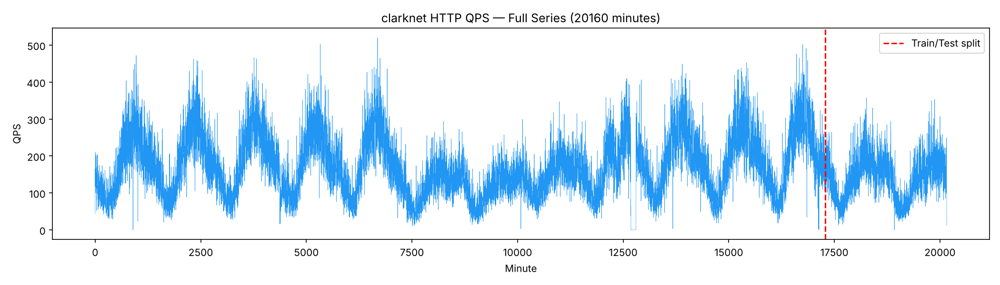
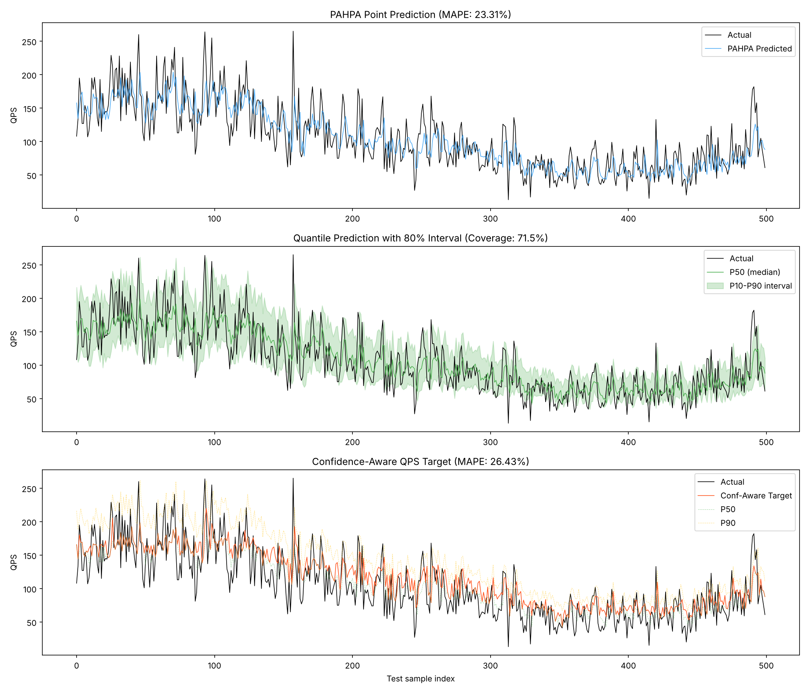
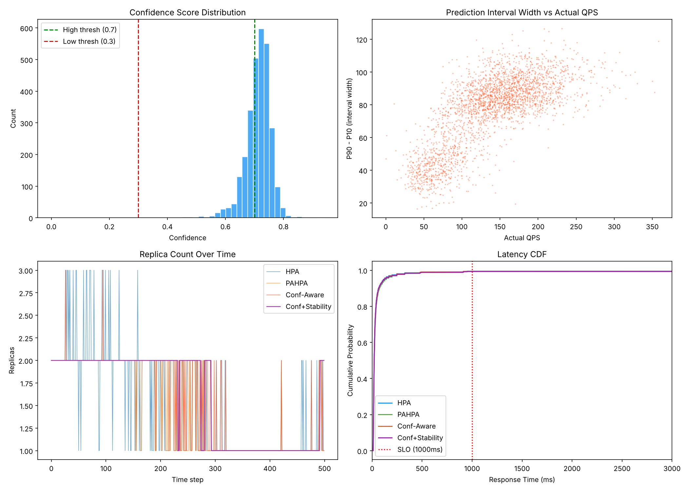

# Generalisation Check: ClarkNet-HTTP

Does the NASA-tuned system (confidence thresholds 0.3/0.7; stability K=3 up, 5-of-7 down, 2.0x burst bypass) still work on a second, unseen real web-traffic trace? **No threshold was retuned.** Both datasets went through the same code, `training/run_pipeline.py`, which is a line-for-line port of `training/train_final_kaggle.ipynb`.

## 1. Datasets

| | NASA-HTTP (reference) | ClarkNet-HTTP (new) |
|---|---|---|
| Source | [ITA NASA-HTTP](https://ita.ee.lbl.gov/html/contrib/NASA-HTTP.html), `NASA_access_log_Jul95.gz` | [ITA ClarkNet-HTTP](https://ita.ee.lbl.gov/html/contrib/ClarkNet-HTTP.html), `clarknet_access_log_Aug28.gz` + `clarknet_access_log_Sep4.gz` (concatenated in time order) |
| Server | NASA Kennedy Space Center WWW server | ClarkNet, a commercial ISP in the Baltimore–Washington DC area |
| Format | Common Log Format | Common Log Format |
| Log lines | 1,891,715 | 3,328,632 (1,654,882 + 1,673,750) |
| Lines failing to parse | 1 (truncated final line) | 100 (see note) |
| Period modelled | 1995-07-01 00:00 → 07-26 08:39 | 1995-08-28 00:00 → 09-10 23:59 |
| Minutes | 39,693 raw, trimmed to **36,520** (notebook rule) | **20,160** (14 full days; the 36,520 trim does not apply) |
| Mean / max load (requests/min) | **48.07** / 405 | **165.11** / 520 (median 156) |
| Zero-request minutes | 153 (0.4%) | 122 (0.6%); 119 of them are a single outage on 09-05 19:24–21:22 |
| Train / test rows | 33,580 / 2,880 | 17,220 / 2,880 |
| Test window | Mon 07-24 08:40 → Wed 07-26 08:39 | **Sat 09-09 00:00 → Sun 09-10 23:59** (a weekend) |
| Test mean / max load | 43.97 / 149 | 139.51 / 358 |

**Note on the 100 ClarkNet parse "errors":** none is a lost request. A handful of request URLs contain a bare carriage return (`\r`). Python's text-mode reader splits a line at `\r`, so the tail of the request (e.g. `HTTP/1.0" 404 207`) shows up as a separate "line" with no timestamp. The head of that line, which carries the timestamp, is counted normally. Read as raw bytes, all 3,328,632 physical lines have a timestamp. The notebook's parser was kept unchanged.

As in the notebook, "QPS" in the code and below means requests per one-minute bucket.



## 2. Pod capacity (service rate)

ClarkNet carries 3.43x NASA's mean load. With NASA's 30 requests/min per pod, the pod counts would not be comparable. So the primary run scales per-pod capacity so that **mean load per pod is the same as NASA's**:

```
service_rate = 30 × (ClarkNet mean / NASA mean) = 30 × 165.111 / 48.067 = 103.05 requests/min per pod
```

The two means are taken over the series each model is trained and tested on: NASA's 36,520-minute trimmed series and ClarkNet's full 20,160 minutes. Mean load per pod is 1.60 on both. SLO stays at 1 s and replicas at 1–15. No system hit the 15-replica ceiling: the most any system used was 4 (HPA), and the actual load never needs more than 4. So `--max-replicas` did not need raising.

A sensitivity run with the original service rate of 30 (max replicas raised to 40; the most needed was 12; no ceiling hits) is in §6.

## 3. Forecast accuracy (test set, 2,880 minutes)

MAPE uses the notebook's floor of 10 in the denominator.

| Model | NASA MAPE | NASA MAE | NASA RMSE | NASA R² | ClarkNet MAPE | ClarkNet MAE | ClarkNet RMSE | ClarkNet R² |
|---|---|---|---|---|---|---|---|---|
| PAHPA point | 32.02% | 11.17 | 14.95 | 0.731 | **23.31%** | 28.08 | 36.67 | **0.581** |
| Quantile P50 | 32.95% | 11.04 | 14.75 | 0.738 | 23.55% | 27.73 | 36.12 | 0.593 |
| Confidence-aware target | 45.28% | 12.71 | 16.20 | 0.684 | 26.43% | 28.85 | 36.89 | 0.576 |

MAPE improves on ClarkNet but R² gets worse (0.73 → 0.58). Neither number means the forecaster is "better" or "worse" in absolute terms:
- **MAPE improves** because, at roughly 140 requests/min, minute-to-minute counting noise (√λ) is a smaller fraction of the load than it is at roughly 44/min.
- **R² falls** because the ClarkNet test window is a quiet weekend with a flatter daily curve. Less of its variance is explainable structure and more is noise.

As on NASA, the P50 model is about as accurate as the point model.



## 4. Prediction interval and confidence

| | NASA | ClarkNet |
|---|---|---|
| P10–P90 coverage (nominal 80%) | 70.7% | 71.5% |
| Below P10 / above P90 | 15.3% / 14.0% | 16.5% / 12.1% |
| Average width (requests/min) | 29.61 | 76.79 |
| Median width | 28.65 | 82.16 |
| Median relative width (P90−P10)/P50 | 0.80 | **0.56** |
| Mean confidence | 0.588 | **0.713** |
| High (> 0.7) → scale to P50 | 24.5% | **68.1%** |
| Medium (0.3–0.7) → blend P50/P90 | 72.8% | 31.8% |
| Low (≤ 0.3) → scale to P90 | 2.6% | **0.0%** |

Coverage carries over well: about 71% on both, with the same slight under-coverage relative to the nominal 80%.

**The confidence distribution does not carry over.** The confidence score uses *relative* width, and relative noise shrinks as load grows. So the busier ClarkNet trace looks "confident" most of the time. Two thirds of decisions fall in the high band, where Objective 1 scales to P50 and behaves almost like PAHPA. The low band (scale to P90) never triggers.

The fixed 0.3/0.7 thresholds are therefore not scale-invariant. This is the main reason the Objective 1 gain is smaller here (§5).



## 5. Scaling simulation: the four systems side by side

Primary run: M/M/c queueing, SLO 1 s. Service rate is 30/pod for NASA and 103.05/pod for ClarkNet; replicas 1–15. The NASA column is the committed reference (`training/reports/training_summary.json`), reproduced exactly by `run_pipeline.py`.

| Metric | Dataset | HPA | PAHPA | Obj 1 (conf-aware) | Obj 1+2 (conf + stability) |
|---|---|---|---|---|---|
| **SLO violation %** | NASA | 19.55 | 20.38 | **12.92** | 13.12 |
| | ClarkNet | 14.31 | 14.62 | **12.36** | 13.47 |
| **Scaling events** | NASA | 1128 | 440 | 355 | **47** |
| | ClarkNet | 828 | 224 | 254 | **26** |
| **Flaps** | NASA | 228 | 79 | 71 | **0** |
| | ClarkNet | 145 | 34 | 44 | **0** |
| Avg pods | NASA | 2.00 | 1.92 | 2.12 | 2.13 |
| | ClarkNet | 1.85 | 1.78 | 1.83 | 1.82 |
| Over-provisioning % | NASA | 10.62 | 6.75 | 12.93 | 13.80 |
| | ClarkNet | 7.95 | 4.21 | 5.64 | 6.03 |
| P99 latency (ms)\* | NASA | 1000.0 | 1008.4 | 1000.0 | 1000.0 |
| | ClarkNet | 568.3 | 911.5 | 911.5 | 911.5 |
| Burst bypass fired (decisive) | NASA | – | – | – | 0 (0) |
| | ClarkNet | – | – | – | 0 (0) |

\* The notebook computes P99 over **finite** latencies only. Overloaded minutes (utilisation ≥ 1, infinite latency) account for about 95% of all violations and are left out. P99 is therefore not a meaningful comparison here; use the SLO violation rate.

"Decisive" counts the times the bypass let a scale-up through that the K=3 rule would otherwise have suppressed.

### Relative changes

| Comparison | NASA | ClarkNet |
|---|---|---|
| Obj 1 vs PAHPA: SLO violations | −7.46 pp (**−37%**) | −2.26 pp (**−15%**) |
| Obj 1 vs PAHPA: scaling events | −19% (440 → 355) | **+13%** (224 → 254) |
| Obj 1 vs PAHPA: flaps | −10% (79 → 71) | **+29%** (34 → 44) |
| Obj 1 vs PAHPA: avg pods | +0.20 | +0.05 |
| Obj 1+2 vs Obj 1: SLO cost | +0.20 pp | **+1.11 pp** |
| Obj 1+2 vs Obj 1: scaling events | −87% | −90% |
| Obj 1+2 vs Obj 1: flaps | 71 → 0 | 44 → 0 |
| Obj 1+2 vs PAHPA: SLO violations | −7.26 pp (−36%) | −1.15 pp (−8%) |
| Obj 1+2 vs HPA: SLO violations | −6.43 pp (−33%) | −0.84 pp (−6%) |

## 6. Sensitivity: service rate 30 (NASA's pod size), max replicas 40

The forecasts are identical to the primary run (`predictions.csv` is byte-identical); only the simulation changes. The full summary is in `training/reports/clarknet/sensitivity_rate30/training_summary.json`.

| Metric | HPA | PAHPA | Obj 1 | Obj 1+2 |
|---|---|---|---|---|
| SLO violation % | 35.17 | 35.38 | 27.67 | 27.64 |
| Scaling events | 2024 | 1218 | 1114 | 149 |
| Flaps | 515 | 259 | 226 | 0 |
| Avg pods | 5.20 | 5.04 | 5.32 | 5.36 |
| Over-provisioning % | 10.69 | 7.46 | 10.38 | 11.40 |
| Burst bypass fired (decisive) | – | – | – | 1 (0) |

With small pods (higher pod counts), the NASA pattern comes back almost exactly:
- Obj 1 cuts violations 22% relative to PAHPA (−7.71 pp) and also cuts events and flaps.
- The stability filter removes all flaps and 87% of events at zero SLO cost (−0.03 pp).

Absolute violation rates are high for every system. A 2,880-minute replay at 5 pods with Poisson-like minute noise overloads often, and the same is true of HPA.

## 7. Answers

**Does Objective 1 still cut SLO violations vs PAHPA?** Yes, but by much less.
- Primary run: −2.26 pp (−15% relative), versus −7.46 pp (−37%) on NASA.
- Sensitivity run: −22% relative.

The gain shrinks because ClarkNet's higher load makes the relative interval width small, so 68% of decisions land in the "high confidence → P50" band and Objective 1 mostly behaves like PAHPA. The NASA-tuned 0.3/0.7 thresholds depend on load scale. That is a real limitation of the confidence score as defined, not something to tune away for this report.

**Things that got worse on ClarkNet:**
- In the primary run, Objective 1 makes **more** scaling decisions than PAHPA (254 vs 224 events, 44 vs 34 flaps). On NASA it made fewer.
- Its over-provisioning is also higher than PAHPA's (5.64% vs 4.21%), as on NASA.

**Does the stability filter still remove flaps at a small SLO cost?** It still removes **all** flaps (44 → 0) and 90% of scaling events. The SLO cost is larger than on NASA, though: **+1.11 pp** (12.36% → 13.47%) versus +0.20 pp.
- Of the 388 Obj 1+2 violations, 56 occur in minutes where Obj 1 alone would have met the SLO. In every one of those 56 minutes the filter was holding fewer pods than Obj 1 proposed (a suppressed or delayed scale-up). 24 go the other way.
- Obj 1+2 still beats PAHPA (−1.15 pp) and HPA (−0.84 pp), but most of Objective 1's SLO gain is given back.
- In the sensitivity run (service rate 30) the SLO cost is zero (−0.03 pp). So the size of the cost depends on how coarse each pod step is: at about 2 pods, one suppressed step is half the capacity.

**Did the burst bypass fire?**
- **Primary ClarkNet run: never** (0 times).
- **NASA reference run: also never.** It wasn't instrumented before; the reproduced NASA run shows 0.
- **Sensitivity run: once**, and in that one case the K=3 rule would have allowed the scale-up anyway (0 decisive).

The 2x-capacity trigger requires a forecast above twice the *current* capacity. No minute in either trace's test window produced such a forecast, so the bypass contributed nothing to any result in either dataset. Its value on genuine flash crowds remains untested by these traces.

**Bottom line:** the qualitative ranking holds on a second real trace with untouched settings:
- Obj 1 has the fewest SLO violations.
- Obj 1+2 has 0 flaps and about 90% fewer scaling events.
- Obj 1+2 still beats PAHPA and HPA on SLO.

The size of the gains does not transfer. Objective 1's SLO benefit falls from −37% to −15%, and the stability filter's SLO cost rises from 0.2 pp to 1.1 pp at the comparable pod size.

## 8. Reproduction

```bash
python3 -m venv .venv && .venv/bin/pip install -r training/requirements-pipeline.txt
mkdir -p training/raw && cd training/raw
for f in NASA_access_log_Jul95 clarknet_access_log_Aug28 clarknet_access_log_Sep4; do
  curl -sSLO https://ita.ee.lbl.gov/traces/$f.gz && gunzip -k $f.gz; done
cd ../..
# ClarkNet primary run (writes prediction/models/clarknet, data/clarknet, training/reports/clarknet)
.venv/bin/python training/run_pipeline.py --name clarknet --service-rate 103.05 --max-replicas 15 --out-dir . \
  --log training/raw/clarknet_access_log_Aug28 training/raw/clarknet_access_log_Sep4
# Sensitivity run (write it somewhere else so it doesn't overwrite the primary outputs)
.venv/bin/python training/run_pipeline.py --name clarknet --service-rate 30 --max-replicas 40 --out-dir /tmp/clarknet_sr30 \
  --log training/raw/clarknet_access_log_Aug28 training/raw/clarknet_access_log_Sep4
# NASA check (write it somewhere else; reproduces data/scaling_simulation.csv byte-for-byte)
.venv/bin/python training/run_pipeline.py --name nasa --log training/raw/NASA_access_log_Jul95 --out-dir /tmp/nasa_check
```

### Port verification on NASA

`run_pipeline.py` reproduces the committed NASA outputs exactly:
- 36,520 rows; every metric in `training_summary.json` identical.
- `data/scaling_simulation.csv` byte-identical.
- `predictions.csv` equal to within 1.4e-14.

Two environment details were needed to get there, and they are now built in:

1. **numpy < 2.4.** numpy 2.4+ changes the last bit of the `np.polyfit` slope feature (feature 145).
2. **OpenBLAS Haswell kernels.** On this machine's CPU, OpenBLAS's SkylakeX kernels give a slope that differs from Kaggle's by 1 ULP. `run_pipeline.py` therefore sets `OPENBLAS_CORETYPE=Haswell` (unless it is already set) before importing numpy.

A 1-ULP feature difference moves a LightGBM bin edge, and over 500 trees that grows into visibly different models. With either detail missing, results drift by up to 0.35 pp SLO and about 16 scaling events. LightGBM version (4.5/4.6/4.7) and thread count made no difference.
